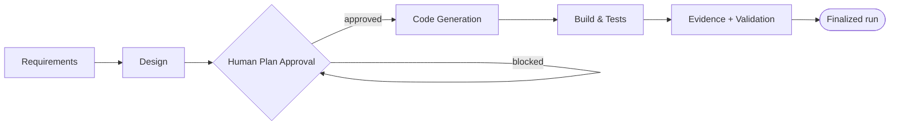

<div align="center">

# AICC Engineering Toolkit

### Standardize AI engineering. Accelerate delivery. Scale with confidence.

**A governed AI-Driven Development Life Cycle (AI-DLC) for Claude Code and Kiro CLI — set up in one command.**

[](https://awslabs.github.io/aidlc-workflows/)
[](https://github.com/awslabs/aidlc-workflows)
[](https://github.com/awslabs/aidlc-workflows/blob/main/LICENSE)
[](https://main.d1p32afqqmff9l.amplifyapp.com/)

</div>

---

## What this is

The **AICC Engineering Toolkit** lets any engineer run AICC's governed AI-DLC
engineering standard — the same lifecycle, governance, and evidence controls we
certified internally — in **their own application project**, using **Claude Code**
or **Kiro CLI**.

- **You download only this public repository.** No access to any private AICC
  platform repo is required.
- One setup command configures the AI-DLC runtime, the AICC adapter, the
  governance controls (including genuine human Plan Approval), the validators,
  and the templates.
- Your existing `CLAUDE.md`, agents, skills, hooks, and project files are
  **preserved**, never silently overwritten.

> The AI-DLC runtime itself is the open-source **AWS Labs**
> [`aidlc-workflows`](https://github.com/awslabs/aidlc-workflows) project
> (license **MIT-0**). This toolkit does **not** redistribute it — the installer
> uses AWS Labs' own official installer so you always get an authentic, signed
> build.

---

## Quick Start (one command per OS)

**Step 1 — get the toolkit**

```bash
git clone https://github.com/lxrsd/AICC_Engineering_Toolkit.git
cd AICC_Engineering_Toolkit
```

**Step 2 — run the one-command setup, pointed at your project**

<table>
<tr><th>OS</th><th>Setup command</th></tr>
<tr>
<td><b>macOS</b></td>
<td>

```bash
python3 installer/install.py --target /path/to/your/project
```

</td>
</tr>
<tr>
<td><b>Linux / WSL2</b></td>
<td>

```bash
python3 installer/install.py --target /path/to/your/project
```

</td>
</tr>
<tr>
<td><b>Windows (PowerShell)</b></td>
<td>

```powershell
py installer\install.py --target C:\path\to\your\project
```

</td>
</tr>
</table>

The installer detects your OS/CPU, detects (or asks for) **Claude Code** or
**Kiro CLI**, checks for the AI-DLC runtime, applies the AICC standard, wires the
approval controls, validates, and prints **READY** or **BLOCKED** with exactly
what to fix.

If the AI-DLC runtime is not yet installed, the installer tells you the official
AWS Labs command and (with your confirmation, `--allow-runtime-install` on
macOS/Linux) can run it for you:

```bash
# macOS / Linux / WSL2
curl -fsSL https://github.com/awslabs/aidlc-workflows/releases/latest/download/install.sh | sh
```
```powershell
# Windows PowerShell
irm https://github.com/awslabs/aidlc-workflows/releases/latest/download/install.ps1 | iex
```

Non-interactive automation: add `--non-interactive --yes --tool claude-code|kiro-cli`.

---

## Supported tools

| Tool | Status | Setup (handled by the installer) | Launch |
|------|--------|----------------------------------|--------|
| **Claude Code** | ✅ Certified (Owner-Authorized Pilot) | `aidlc config --harness claude` | `claude` → `/aidlc` |
| **Kiro CLI** | ✅ Certified (Owner-Authorized Pilot) | `aidlc config --harness kiro` | `kiro-cli chat` → `/aidlc` |
| Cursor | ⏳ Pending (placeholder only) | — | — |
| Kiro IDE | ❌ Not certified on this toolkit | — | — |

Certification status is read from the sanitized public registry
(`capabilities/ai-dlc/validators/public-registry.json`), a projection of AICC's
authoritative registry. Only certified tools are offered as approved options.

### Your existing agents & skills are preserved

The installer namespaces the AICC standard under `<your-project>/.aicc/ai-dlc/`
and runs the runtime's own `aidlc config`, which reports a plan and does not
clobber your files. Existing `CLAUDE.md`, `.claude/agents`, `.claude/skills`,
`.claude/hooks`, `.kiro/`, and `AGENTS.md` are detected and preserved; conflicts
are reported, never silently overwritten.

---

## The AI-DLC lifecycle


<!-- Text fallback: Requirements -> Design -> Human Plan Approval gate (code
generation is blocked until a real human approves) -> Code Generation ->
Build & Tests -> Evidence + Validation -> Finalized run. -->

Each stage produces traceable artifacts. The lifecycle maps to the six Workbench
tabs: **Requirements, Design, Approval, Code, Tests, Evidence.**

## Genuine human approval & governance

AI code generation **cannot begin** until a real human approves the plan. The
runtime records a protected `HUMAN_TURN` authority event only when a real prompt
flows through your tool's interactive prompt-submit hook, using an uncopyable
token. Driving the engine from outside that interactive seam records no
`HUMAN_TURN`, and the engine refuses the approval — **by design**.

- Approvals are **never fabricated** and gates are **never bypassed**.
- Verify your environment enforces it:
  `python3 .aicc/ai-dlc/validators/preflight.py --tool <tool> --require-human-turn`
- CI/validators check committed evidence only; they never claim to verify
  protected approval receipts they cannot see.

---

## Start building

1. Open your tool's interactive AI-DLC agent (`claude`, or `kiro-cli chat`).
2. Run `/aidlc "Build <your application>"`.
3. Answer each stage; **approve at the gate as a real human**.
4. The tool generates real application code, runs build + tests, performs an
   independent review, and produces evidence.

## Build, test & validate evidence

```bash
# Validate the toolkit's own evidence contract + independence:
python3 capabilities/ai-dlc/validators/exporter/test_evidence.py
python3 installer/test_independence.py

# After a governed run, export + validate your sanitized evidence:
python3 .aicc/ai-dlc/validators/exporter/export_evidence.py --descriptor <run>.json --repo-root . --out evidence-manifest.json
python3 .aicc/ai-dlc/validators/exporter/validate_evidence.py evidence-manifest.json --repo-root . --check-artifacts
python3 .aicc/ai-dlc/validators/check_sensitive_files.py --repo-root .
```

## Workbench

See a live demonstration of certified Kiro CLI and Claude Code runs on the AICC
AI-DLC Workbench:

**→ https://main.d1p32afqqmff9l.amplifyapp.com/**

---

## Prerequisites

- **Python 3.9+** (for the installer and validators).
- **Your AI tool**: Claude Code (`claude`) or Kiro CLI (`kiro-cli`), installed from its vendor.
- **The AI-DLC runtime** (`aidlc`): installed by the Quick Start, or already on your PATH (`aidlc version` → 2.10.0+).
- Supported OS/CPU per the AWS Labs runtime: macOS (arm64/x64), Linux (arm64/x64, incl. musl), Windows (x64). On Windows, use PowerShell for the runtime installer, or WSL2 with the Linux command.

## Troubleshooting

| Symptom | Fix |
|---------|-----|
| `aidlc: command not found` after install | Open a new terminal (PATH update), or follow the installer's PATH instruction. |
| Installer prints **BLOCKED: runtime not found** | Run the official AWS Labs install command for your OS (above), then re-run the installer. |
| Installer prints **BLOCKED: `<tool>` not found** | Install Claude Code or Kiro CLI from its vendor, then re-run. |
| Approvals are refused | That is the control working. Launch the **interactive** agent (`claude` / `kiro-cli chat`) so a real `HUMAN_TURN` is recorded; don't drive the engine from a non-interactive shell. |
| Windows: `install.sh` fails in PowerShell | Use the PowerShell command (`irm … install.ps1 | iex`) or WSL2 with the Linux command. |
| `aidlc doctor` reports problems | Follow its suggested fixes; re-run the installer with `--force` to refresh the AICC standard. |

## Scope & honesty

- **Certified** = proved the complete governed lifecycle end-to-end in a real run
  (owner-authorized pilot, subject to corporate review on migration). Pending,
  failed, and future states are shown honestly.
- **Cursor** and **Factory AI** are placeholders — not implemented, not certified.
- This toolkit configures and references the AWS Labs runtime; it does not fork
  or redistribute it.

## License

This toolkit's AICC-authored materials are maintained by AICC. The AI-DLC runtime
is AWS Labs `aidlc-workflows` under **MIT-0**; see its repository for terms.
