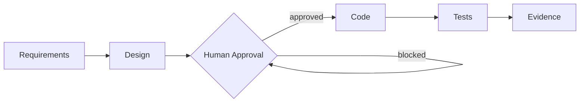

<div align="center">

# AICC Engineering Toolkit

### Standardize AI engineering. Accelerate delivery. Scale with confidence.

[](https://awslabs.github.io/aidlc-workflows/)
[](https://github.com/awslabs/aidlc-workflows)
[](https://github.com/awslabs/aidlc-workflows/blob/main/LICENSE)

</div>

The AICC Engineering Toolkit establishes a unified **AI-Driven Development Life
Cycle (AI-DLC)** methodology designed to transform how engineering teams plan,
build, review, and deliver software.

By combining AI-assisted development with structured engineering practices, human
oversight, automated validation, and traceable evidence, the Toolkit helps teams
accelerate delivery, improve software quality, reduce development risks, and build
with greater consistency and confidence.

> **One methodology. Multiple AI tools. A better way to engineer software.**

The Toolkit is **not primarily an installer** — it is a methodology you apply to
your own projects, using the official AWS Labs AI-DLC runtime and the AI coding
tool your team already uses. It is a **public** repository and requires **no AWS
account** to use.

---

## Why AICC Engineering Toolkit?

These are the intended outcomes of adopting the methodology — goals it is
designed to support, not measured performance claims.

| | What it means |
|---|---|
| 🚀 **Build faster** | Reduce repetitive work and unnecessary rework through structured, AI-assisted workflows. |
| 🧠 **Build smarter** | Turn ideas into clear requirements, solution designs, and implementation plans before code is written. |
| 🛡️ **Build safer** | Integrate human approval, testing, independent review, and governance into the flow. |
| 🔁 **Build consistently** | Adopt one engineering methodology across every supported AI development tool. |
| ✅ **Build with confidence** | Keep traceable decisions, validations, and delivery evidence for every run. |

---

## The AI-DLC Engineering Journey

AI-assisted development here is **not** "ask an AI to generate code." The
methodology guides an intentional journey — documented requirements, deliberate
design, human review, validation, and auditable results:



| Stage | What the engineer does | Why it matters |
|-------|------------------------|----------------|
| **Requirements** | Capture the problem, intended outcome, and constraints. | Everyone builds the right thing, not just *a* thing. |
| **Design** | Decide the technical approach and implementation plan. | Architecture choices are deliberate and recorded. |
| **Human Approval** | A real person approves the plan at the gate. | A human — not the AI — authorizes what gets built. |
| **Code** | The AI generates the implementation against the plan. | Code follows an approved design, not an ad-hoc prompt. |
| **Tests** | Build and automated tests run. | Behavior is checked, not assumed. |
| **Evidence** | Traceable artifacts (paths, hashes, results) are produced. | The run is auditable end to end. |

> **Honest limit.** Project instructions *guide* a tool; the runtime's hooks are
> what *enforce* the gates. Independently verified approval enforcement exists
> only for harnesses that passed real end-to-end acceptance. Today **Claude Code
> and Kiro CLI** have owner-authorized AICC pilot demonstrations; the other five
> harnesses are upstream-supported but **not AICC-certified** and are untested by
> AICC on a real machine. See [Supported AI development tools](#supported-ai-development-tools).

---

## Get started — five steps

Setup is two things, kept separate: a **one-time computer setup** (Step 1), then
**per-project configuration** (Step 3). You do **not** reinstall the runtime for
each project.

### Step 1 — One-time computer setup

Do this **once per machine**.

**Install the official AI-DLC runtime (`aidlc`):**

| OS | Install command |
|----|-----------------|
| **macOS** | `curl -fsSL https://github.com/awslabs/aidlc-workflows/releases/latest/download/install.sh \| sh` |
| **Windows** (PowerShell) | `irm https://github.com/awslabs/aidlc-workflows/releases/latest/download/install.ps1 \| iex` |

These run the **official AWS Labs installer** (it verifies its own
checksums/signatures). Confirm it:

```bash
aidlc version      # expect 2.10.0 or newer
```

Then **install an approved AI development tool** (e.g. Claude Code or Kiro CLI) —
the Toolkit does not install your editor/CLI for you.

> **Corporate-managed machines.** Security policy (PowerShell execution policy,
> an SSL-inspection proxy such as Netskope, or blocked downloads) may prevent the
> automatic install. Use the **IT-approved manual/offline** path instead — never
> bypass a security control:
> 1. On a permitted machine, download the official release asset for your OS/arch
>    from <https://github.com/awslabs/aidlc-workflows/releases> **and** its
>    `checksums.txt`.
> 2. **Verify SHA-256** before use — `shasum -a 256 ./aidlc-<os>-<arch>` (macOS)
>    or `(Get-FileHash -Algorithm SHA256 .\aidlc-windows-x64.exe).Hash` (Windows)
>    — compared against `checksums.txt`.
> 3. Put the verified binary in a user-scope folder on `PATH`
>    (`%USERPROFILE%\.local\bin` on Windows, `~/.local/bin` on macOS), open a new
>    terminal, and confirm `aidlc version`.

### Step 2 — Download the AICC Engineering Toolkit

```bash
git clone https://github.com/lxrsd/AICC_Engineering_Toolkit.git
# — or — download the ZIP from the GitHub "Code" button and extract it
cd AICC_Engineering_Toolkit
```

Keep this folder **separate from** your application projects — it configures
them; it is not where your app lives.

### Step 3 — Create and configure a project

Point `--target` at a **new or existing** project folder and pick your tool with
`--harness`:

```bash
# macOS / Linux
python3 installer/install.py --target /path/to/your/project --harness claude

# Windows (PowerShell) — keep quotes if the path has spaces (e.g. OneDrive)
py installer\install.py --target "C:\path\to\your project" --harness claude
```

Use `--harness kiro` for Kiro CLI, or any id from
[Supported AI development tools](#supported-ai-development-tools). List them with
`python3 installer/install.py --list-harnesses`.

The installer, in your project, **non-destructively** applies the AICC AI-DLC
standard, validators and templates under `.aicc/ai-dlc/`; configures the official
engine surface for your harness and verifies it was created; and writes a
tool-neutral **`AGENTS.md`** plus a thin **`CLAUDE.md`** pointer and a Kiro
steering pointer. Your existing files, hooks, and settings are preserved. Add
`--dry-run` to preview, `--force` to refresh the standard. **No AWS account or
connectivity is required.**

### Step 4 — Start building

Open your **project folder** in your AI tool and describe what to build (e.g.
*"Build me an Expense Tracker web application."*). Where supported, the tool
discovers the AI-DLC methodology from the project instructions; you can also
invoke it explicitly:

| Harness | Start command |
|---------|---------------|
| Claude Code, Kiro CLI, Kiro IDE, Cursor, opencode, GitHub Copilot | `/aidlc` |
| **Codex CLI** | `$aidlc` |

AI-DLC then guides you through **Requirements → Design → Human Approval → Code →
Tests → Evidence**. On the certified harnesses, code generation is blocked until
you approve the plan as a real person.

### Step 5 — Save the project and evidence

Your code and AI-DLC artifacts are **yours** and live in **your** project folder.
Commit them to **your own** GitHub repository. Review before you publish:

```bash
cd /path/to/your/project

# 1. Initialize Git FIRST if this folder is not already a repository.
git init                     # skip if "git status" already works here

# 2. Review what will (and won't) be committed.
cat .gitignore               # ensure secrets/local files are excluded (.env, etc.)
git status

# 3. Run the safety + evidence checks (local, no AWS).
python3 .aicc/ai-dlc/validators/check_sensitive_files.py --repo-root .

#    Evidence is validated against a MANIFEST, which you GENERATE first from your
#    run descriptor. Generate it, THEN validate it:
python3 .aicc/ai-dlc/validators/exporter/export_evidence.py \
    --descriptor <your-run-descriptor>.json --repo-root . --out evidence-manifest.json
python3 .aicc/ai-dlc/validators/exporter/validate_evidence.py \
    evidence-manifest.json --repo-root . --check-artifacts

# 4. Stage (prefer naming files over "git add .") and review the staged diff.
git add <files you want to commit>
git diff --cached            # read this before committing

# 5. Commit and push to YOUR repository.
git commit -m "AI-DLC: requirements, design, code, tests, evidence"
git branch -M main
git remote add origin https://github.com/<you>/<your-project>.git
git push -u origin main
```

If a validator reports a problem, fix it before staging. Don't commit until
`git diff --cached` shows only what you intend to publish. **No AWS account or
connectivity is required** to generate, validate, or store your evidence.

---

## Supported AI development tools

All seven official AWS Labs AI-DLC harnesses can be configured. Three statuses
are kept distinct and honest:

- **Upstream support** — the official AWS Labs runtime supports the harness.
- **AICC certification** — AICC proved the governed lifecycle end-to-end in an
  owner-authorized pilot. Only **Claude Code** and **Kiro CLI** are certified.
- **Toolkit integration** — how far *this Toolkit's* own integration is proven.

| Harness id | Tool | Invoke | Upstream | AICC certification | Toolkit integration |
|-----------|------|--------|----------|--------------------|---------------------|
| `claude` | Claude Code | `/aidlc` | ✅ | ✅ Owner-authorized pilot | PARTIAL¹ |
| `kiro` | Kiro CLI | `/aidlc` | ✅ | ✅ Owner-authorized pilot | PARTIAL¹ |
| `kiro-ide` | Kiro IDE | `/aidlc` | ✅ | — not certified | UNTESTED² |
| `codex` | Codex CLI | **`$aidlc`** | ✅ | — not certified | UNTESTED² |
| `cursor` | Cursor | `/aidlc` | ✅ | — not certified | UNTESTED² |
| `opencode` | opencode | `/aidlc` | ✅ | — not certified | UNTESTED² |
| `copilot` | GitHub Copilot | `/aidlc` | ✅ | — not certified | UNTESTED² |

¹ **PARTIAL** — Toolkit logic plus automated tests and prior owner-authorized
pilot runs; current end-to-end acceptance on a corporate-managed machine is still
pending (no new completed Windows acceptance is claimed).
² **UNTESTED** — the Toolkit configures the harness and verifies the engine
surface, but there has been **no AICC real-machine acceptance**; these are not
presented as AICC-certified.

Codex invokes with `$aidlc` (not `/aidlc`) and requires the project to be a git
repository. `kiro`, `kiro-ide`, `codex`, `cursor`, and `opencode` can coexist in
one project; **GitHub Copilot's root block is exclusive** — configure it alone.

---

## Explore Our AI-DLC Demonstrations & Evidence

AICC has previously tested and demonstrated the governed AI-DLC methodology using
**Kiro CLI** and **Claude Code** in owner-authorized pilots. The existing AWS
Amplify Workbench lets you **explore those completed demonstrations**, review the
lifecycle evidence, and see how governance was applied during those runs.

**[View AICC AI-DLC Workbench — Certified Demonstrations](https://main.d1p32afqqmff9l.amplifyapp.com/)**

This Workbench is **only AICC's existing demonstration and proof environment**.
It is **not**:

- a required part of engineer onboarding,
- a service you register with or authenticate to,
- an evidence-sync destination for your projects,
- a per-project Workbench generated for you, or
- a replacement for your own GitHub repository.

You never connect, register, upload evidence, or provision a Workbench. Your own
work stays in **your** GitHub repository (Step 5).

### What to Look for in the Evidence

A one-minute guide to reading the Kiro CLI and Claude Code demonstration records.
*(This is a conceptual guide to the lifecycle stages; use the labels and fields
the Workbench actually displays as you browse.)*

1. **Requirements** — the documented problem, intended outcome, and project
   requirements for the run.
2. **Design** — the proposed technical approach, design decisions, and
   implementation plan.
3. **Human Approval** — the recorded approval checkpoint and evidence that
   approval **preceded** implementation. An approval *label* alone is not proof
   of an enforced gate — look for the ordering and the recorded authority event.
4. **Code** — implementation artifacts and references to the actual application
   code produced.
5. **Tests** — test execution results: what ran, what passed or failed, and the
   validation details.
6. **Evidence** — traceable artifacts (file references, hashes, validation
   records) tying the earlier stages to the final outcome.

**Read it critically.** Evidence *displays* what a run produced and *supports* a
claim that the lifecycle was followed — it does **not** independently prove your
own future runs will behave identically. A record with **missing artifacts,
failing tests, or incomplete approval documentation is not a successfully
verified lifecycle** and should not be read as one.

---

## Troubleshooting

| Symptom | Fix |
|---------|-----|
| `aidlc: command not found` after install | Open a new terminal (PATH refresh); detection also searches `%USERPROFILE%\.local\bin`. |
| Installer prints **BLOCKED: runtime not found** | Complete Step 1 (install the runtime), then re-run. |
| Tool reported **NOT found** | Install your AI tool from its vendor (or get IT approval), then re-run. |
| PowerShell: *"running scripts is disabled"* | Use IT's approved method for the runtime one-liner, or the manual/offline install in Step 1. |
| `CERTIFICATE_VERIFY_FAILED: CA cert does not include key usage extension` (Netskope) | Ask IT to re-issue the inspection CA with `keyUsage=critical,keyCertSign,cRLSign`. Local setup needs no network and is unaffected. |
| `PermissionError [WinError 5]` under `OneDrive - <org>` | The installer no longer recursively deletes config dirs and clears read-only bits — keep quotes around spaced paths and re-run. |
| Approvals are refused | That is the control working. Launch the **interactive** agent so a real `HUMAN_TURN` is recorded; don't drive the engine from a non-interactive shell. |

Prerequisites (one-time, per machine): the official **AI-DLC runtime** (`aidlc`
≥ 2.10.0), **your AI tool**, and **Python 3.9+**. Supported OS/CPU per the AWS
Labs runtime: macOS (arm64/x64), Linux (arm64/x64), Windows (x64). On Windows use
PowerShell, or WSL2 with the **Linux** installation instructions. No AWS account
or connectivity is required.

---

## License

This Toolkit's AICC-authored materials are maintained by AICC. The AI-DLC runtime
is the open-source **AWS Labs** [`aidlc-workflows`](https://github.com/awslabs/aidlc-workflows)
project under **MIT-0** — this Toolkit configures and references it, and never
forks or redistributes it. See the AWS Labs repository for its terms.
